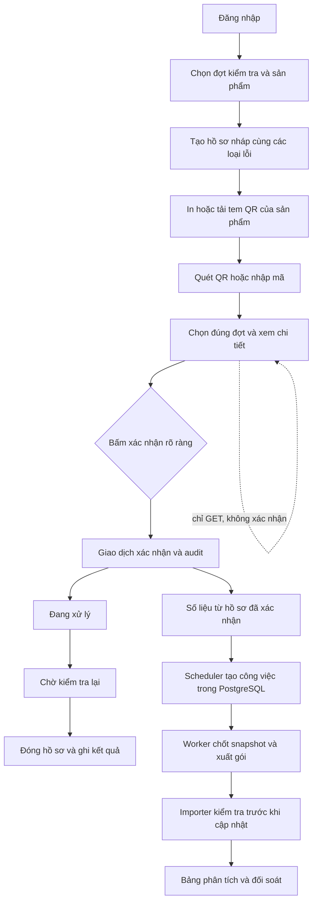
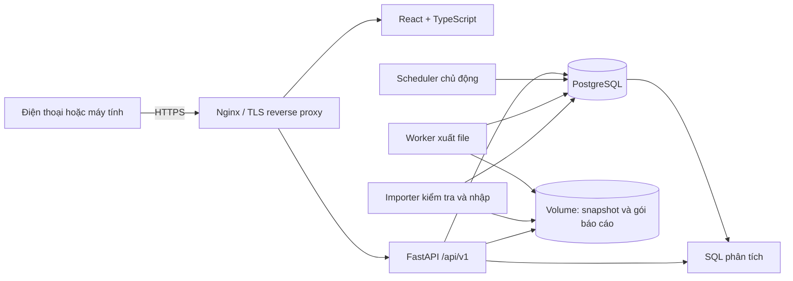
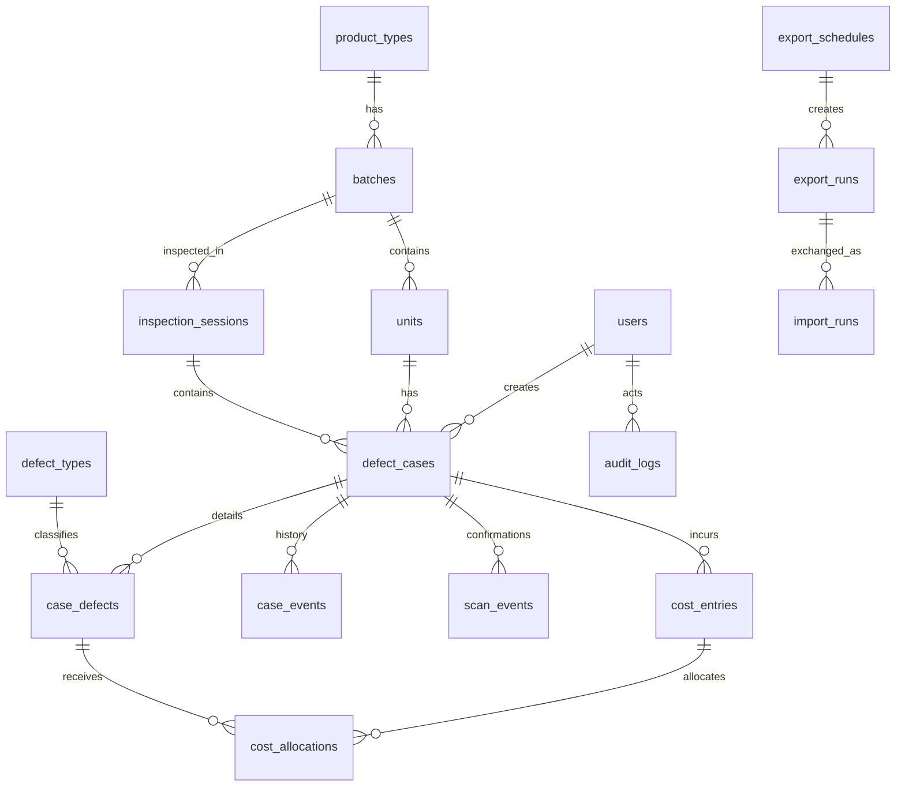

# Thiết kế và phạm vi

## Giả định trước khi viết mã

1. MVP dành cho một tổ chức; chưa chia tenant hoặc nhà máy độc lập. Quản trị viên phải kiểm soát tài khoản và danh mục.
2. Một đợt kiểm tra thuộc đúng một lô, dây chuyền, ca và công đoạn. Số đã kiểm tra là dữ liệu đầu vào có nguồn, không lấy tổng sản lượng thay thế.
3. Một sản phẩm vật lý có một mã nội bộ/serial và một QR bền vững. Một sản phẩm chỉ có một hồ sơ gốc trong một đợt; đợt mới dùng lại sản phẩm và QR.
4. Một lượt lỗi là một lần xuất hiện của một loại lỗi trên sản phẩm, được người kiểm tra ghi nhận. Một sản phẩm có thể có nhiều lượt và loại lỗi.
5. Thời gian lưu ở UTC, hiển thị theo múi giờ IANA; mặc định vận hành Việt Nam là `Asia/Ho_Chi_Minh`. Kỳ báo cáo là `[đầu kỳ, cuối kỳ)`.
6. Mẫu số tổng hợp hiện tính theo các đợt kiểm tra được chọn. Nếu mẫu giữa các đợt chồng lấn, kết quả là tỷ lệ theo lượt kiểm tra; không thể tự suy ra tỷ lệ sản phẩm vật lý duy nhất từ số tổng.
7. Chỉ dùng chi phí có chứng từ/nguồn ghi nhận; khoản ước tính và thực tế tách riêng. Dữ liệu thiếu không được coi là 0.
8. MVP dùng người chọn lỗi. Không có nhận diện lỗi bằng ảnh hoặc suy luận nguyên nhân tự động.

## Luồng nghiệp vụ

Tạo tem chưa làm tăng số lỗi. Xác nhận lại chỉ mở hồ sơ/trả kết quả cũ. In lại giữ nguyên QR. Hủy giữ lịch sử và lý do; không xóa hồ sơ để sửa chỉ số.

## Kiến trúc

Nguồn dữ liệu chính là PostgreSQL. Tiến trình lịch và worker độc lập với điện thoại, sử dụng công việc bền vững trong database. Cách này giảm một lớp Redis/Celery ở MVP: claim bằng khóa PostgreSQL, trạng thái/thử lại/heartbeat nằm cùng nguồn có thể đối soát. Đổi lại, cần giới hạn số worker và theo dõi tải database; có thể đưa Celery/Redis vào sau nhưng không bỏ sổ công việc PostgreSQL.

Hosting tĩnh chỉ phục vụ giao diện; không chạy được FastAPI/PostgreSQL/worker. Bản triển khai đầy đủ dùng Docker Compose hoặc hạ tầng tương đương, cùng hostname để cookie/CSRF hoạt động nhất quán.

## Quan hệ dữ liệu

Ràng buộc chủ chốt: QR token duy nhất, serial duy nhất theo phạm vi khai báo, cặp `(inspection_session_id, unit_id)` duy nhất, `client_event_id` duy nhất và `business_key` công việc xuất duy nhất. Mỗi sửa hồ sơ kiểm tra `row_version` và tăng phiên bản. Tiền dùng `NUMERIC`, không dùng float.

Mô hình đầy đủ còn cần bảng minh chứng, cấu hình ngưỡng cảnh báo, chính sách lưu trữ và các trường nguồn mẫu số khi kết nối hệ thống sản xuất. Chức năng nào chưa có được liệt kê trong README và biên bản kiểm chứng; sơ đồ không phải bằng chứng chức năng đã chạy.

## Màn hình và thao tác tại hiện trường

| Màn hình | Hành động chính | Kiểm soát lỗi |
|---|---|---|
| Đăng nhập | Điền tài khoản, mật khẩu; hiển thị người đang dùng | Không lưu mật khẩu/QR token vào log; báo phiên hết hạn |
| Tổng quan | Xem mẫu số, sản phẩm lỗi, lượt lỗi, trạng thái | Hiển thị phạm vi và dữ liệu thiếu; truy về hồ sơ |
| Tạo hồ sơ | Chọn đợt, serial/sản phẩm, một hoặc nhiều lỗi | Giá trị mặc định; không tự xác nhận sau tạo |
| Tem QR | Xem/tải PNG hoặc PDF, in lại | Giữ nguyên token; có mã nhập tay, sản phẩm và lô |
| Quét | Xin camera, quét hoặc nhập mã thủ công | Giải thích HTTPS/quyền camera; phải bấm xác nhận |
| Danh sách | Tìm kiếm, phân trang, lọc trạng thái | Không tải vô hạn; loại lọc hợp lệ |
| Chi tiết | Lịch sử, người phụ trách, biện pháp, kết quả | Lý do sửa; xử lý xung đột phiên bản |
| Phân tích | Pareto, xu hướng, số liệu và dữ liệu nguồn | Không 0% khi thiếu mẫu số; dự báo có lý do từ chối |
| Xuất/nhập | Chạy ngay, theo dõi trạng thái và tải file | Trả công việc 202; không báo thành công khi mới xếp hàng |
| Settings | Bật/tắt, giờ/ngày, múi giờ và kỳ lịch xuất | Tính lại lần chạy; không lấy timer trình duyệt làm scheduler |

Nút chính đủ lớn, nhãn tiếng Việt rõ, layout thích ứng điện thoại. Thời gian/người thao tác lấy từ phiên máy chủ; thông tin ca/dây chuyền lấy từ đợt đã chọn. Màn hình xem QR tuyệt đối không có side effect.

## Các giai đoạn

| Giai đoạn | Mục tiêu | Điều kiện trước khi dùng thật |
|---|---|---|
| 1 — MVP | Danh mục, đợt kiểm tra, hồ sơ/QR, xác nhận chống trùng, trạng thái, báo cáo, lịch xuất và importer | Kiểm thử PostgreSQL thật, phân quyền, lịch/retry; kiểm tra tem và camera thật; diễn tập khôi phục |
| 2 | Ảnh minh chứng, bridge HTTPS tài khoản dịch vụ, hàng chờ offline theo tài khoản, cảnh báo nâng cao | Giới hạn file/IndexedDB; kiểm thử đổi tài khoản, mất mạng và đường dẫn bridge |
| 3 | Dự báo có kiểm chứng thời gian, SPC phù hợp, tích hợp MES/ERP, hỗ trợ nhận diện ảnh | Dữ liệu gán nhãn/chuỗi thời gian phù hợp; baseline, sai số và độ bất định; không thay xác minh nghiệp vụ |

Giai đoạn là phạm vi thiết kế. Trạng thái thực thi cuối cùng xem README và [verification.md](verification.md).
